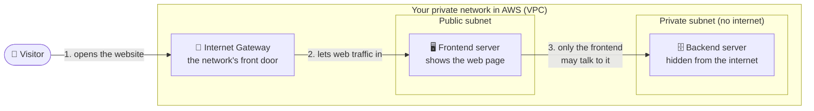
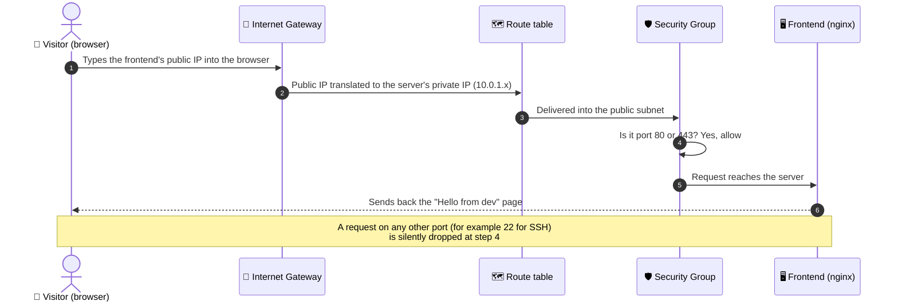
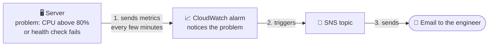
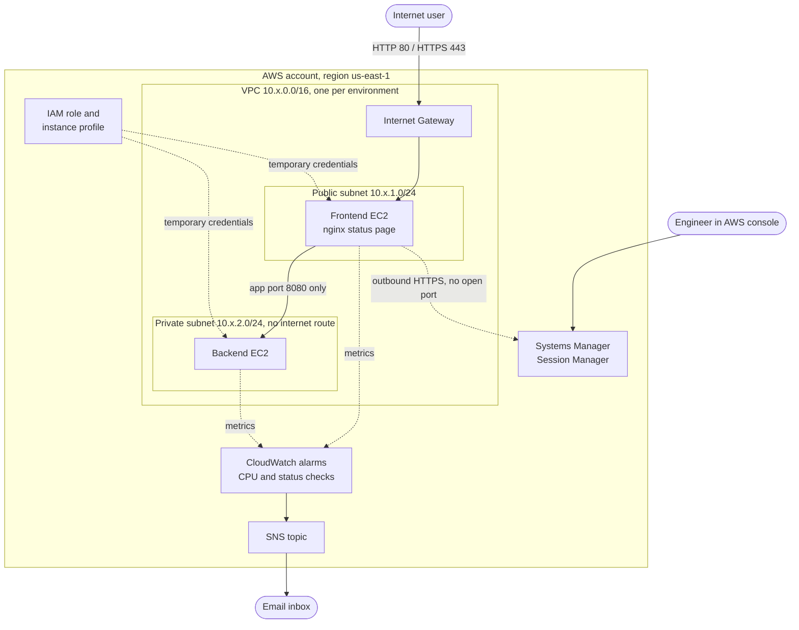

# Multi-Environment AWS Infrastructure with Terraform

Reusable, secure and cost-conscious AWS infrastructure for **dev**, **staging** and **prod**, built entirely with Terraform modules.

This README answers three questions: **what I built**, **why I made each decision**, and **what I would change for production**. It also records what broke during the build and how it was fixed.

> **Scope note:** this is a learning project, built and tested in a personal AWS account. Everything marked ✅ was deployed and verified in AWS. Costs are estimates from AWS list prices, not from a real bill.

## Tech stack
<p align="center">  </p> <p align="center">        </p>

---

## Contents

1. [The business problem](#1-the-business-problem)
2. [Results at a glance](#2-results-at-a-glance)
3. [Architecture](#3-architecture)
4. [Design decisions and trade-offs](#4-design-decisions-and-trade-offs)
5. [Production engineering review](#5-production-engineering-review)
6. [What broke and how it was fixed](#6-what-broke-and-how-it-was-fixed)
7. [How to use this repository](#7-how-to-use-this-repository)
8. [What I would change for production](#8-what-i-would-change-for-production)
9. [Repository structure](#9-repository-structure)

---

## 1. The business problem

A growing SaaS company runs three environments: **development**, **staging** and **production**. Built by hand in the AWS console, they slowly become different from each other (*configuration drift*). A change tested in staging then behaves differently in production, servers are left open to the internet by mistake, and nobody is sure what is running or what it costs.

**Goal:** provision all three environments from the **same code**, so that:

- they differ **only** where we decide they should (address ranges, instance sizes)
- security rules are written once and applied everywhere
- any environment can be created, tested and deleted on demand, so we pay only while it is in use
- failures are noticed automatically, not by a customer

---

## 2. Results at a glance

There are no real users or revenue in a learning project, so the metrics below are the **engineering outcomes** that drive the business goals above. ✅ means measured in this project's test runs.

| Question | Result | Evidence |
|---|---|---|
| **Consistency:** how different are the environments? | ✅ `main.tf`, `variables.tf` and `outputs.tf` are the same in dev, staging and prod, apart from the environment name in comments. **All real differences live in one small `terraform.tfvars` file per environment.** | `diff` between environment folders |
| **Speed:** how long to build an environment from nothing? | ✅ **One command** (`terraform apply`) creates **27 resources**. The EC2 instances were ready in **16 to 18 seconds**, and the web page was served **within the same minute** nginx started. | `apply` output; nginx start time matched the page's "Deployed at" time |
| **Clean-up:** how long to remove it? | ✅ **One command** (`terraform destroy`) removes everything in dependency order. The slowest step, instance termination, took **about 32 seconds**. | `destroy` output: 21 resources destroyed before monitoring was added, 27 after |
| **Security:** how many admin ports are open to the internet? | ✅ **Zero.** No SSH port and no key pairs. Shell access uses AWS Systems Manager Session Manager. | Security Group rules; live Session Manager session as `ssm-user` |
| **Detection:** how fast is a failure noticed? | ✅ A failed health check raises an alarm after **2 minutes**; sustained high CPU after **10 minutes**. Both send email through SNS. | 4 alarms created and reached `OK`; a manual `ALARM` transition was accepted |
| **Cost:** what does it cost to run? | About **$21/month** per dev or staging environment and **$36/month** for prod if left running 24/7 (estimates). A one-hour test cycle costs **a few cents**. | [Cost section](#cost-is-there-any-unnecessary-aws-resource) |
| **Cost avoided:** what did design choices save? | **About $99/month** by not using NAT Gateways (one per environment × 3), more than the three environments cost to run. | NAT Gateway list price; [cost section](#cost-is-there-any-unnecessary-aws-resource) |

---

## 3. Architecture

Each environment (dev, staging, prod) is an identical, isolated copy of this layout, in its own VPC with its own address range.

### The big picture

A visitor reaches the **frontend** server through the Internet Gateway. The **backend** server sits in a private subnet with no internet access; only the frontend can talk to it.



### What happens when someone opens the website



### How the engineer finds out about a problem



<details>
<summary><b>Full architecture diagram (for engineers)</b>: adds IAM, Session Manager and monitoring</summary>



</details>

### Address ranges and sizes per environment

| Environment | VPC CIDR | Public subnet | Private subnet | Instance size |
|---|---|---|---|---|
| dev | `10.0.0.0/16` | `10.0.1.0/24` | `10.0.2.0/24` | t3.micro |
| staging | `10.1.0.0/16` | `10.1.1.0/24` | `10.1.2.0/24` | t3.micro |
| prod | `10.2.0.0/16` | `10.2.1.0/24` | `10.2.2.0/24` | t3.small |

### Modules

| Module | Creates | Resources |
|---|---|---|
| `network` | VPC (DNS enabled), public and private subnets, Internet Gateway, public route table with a default route, private route table with the local route only | 9 |
| `security` | Frontend and backend Security Groups, using separate rule resources | 7 |
| `iam` | EC2 role trusted only by the EC2 service, `AmazonSSMManagedInstanceCore` attachment, instance profile | 3 |
| `compute` | Frontend instance (public subnet, startup script) and backend instance (private subnet, no public IP) | 2 |
| `monitoring` | SNS topic, optional email subscription, 2 CPU alarms, 2 status-check alarms | 5–6 |

Each environment folder (`environments/dev`, `staging`, `prod`) is its own Terraform root module with its own state, and calls the five modules.

---

## 4. Design decisions and trade-offs

| Decision | Why | Alternative | Trade-off accepted |
|---|---|---|---|
| **One folder per environment**, each with its own state | Strong isolation: a mistake in dev cannot touch prod's state. Very explicit for reviewers. | Terraform workspaces; Terragrunt | Some duplicated wiring code across three folders (see [section 8](#8-what-i-would-change-for-production)) |
| **All differences in `terraform.tfvars`** | Code stays identical; differences are small and easy to review | Hard-coded `locals` per environment | `terraform.tfvars` is not in Git; a committed `example.tfvars` documents the values |
| **Reusable modules** (network, security, iam, compute, monitoring) | Each module has one job, so it can be read, tested and changed independently | One large file per environment | More files, and more inputs and outputs to wire together |
| **No NAT Gateway** | About $33/month per environment, more than everything else combined | NAT Gateway; NAT instance; VPC endpoints | The backend has **no internet access**: no OS updates and no Session Manager access to it |
| **Single Availability Zone** per environment | Simpler, and avoids cross-AZ data charges | Two AZs per environment | One AZ outage takes the whole environment down |
| **Separate Security Group rule resources** (`aws_vpc_security_group_ingress_rule`) | Current AWS provider practice; each rule shows up individually in plans | Inline `ingress {}` blocks | Slightly more code |
| **Backend accepts traffic only from the frontend's Security Group** | Rules follow the *role* of a server, not an IP address that can change | CIDR-based rule | None significant |
| **Backend outbound limited to the VPC CIDR** | No internet route exists anyway; the rule documents and enforces intent | Allow all outbound | Must be widened if endpoints or a NAT are added later |
| **No SSH; Session Manager instead** | Removes port 22 and key files from the attack surface | SSH with key pairs; bastion host | Needs IAM permissions for the operator and outbound HTTPS from the instance |
| **IAM role + instance profile** for EC2 | Instances get short-lived credentials automatically; no access keys stored on servers | Access keys on the instance | None; this is the AWS-recommended pattern |
| **IMDSv2 required** (`http_tokens = "required"`) | Protects instance credentials against server-side request forgery attacks | IMDSv1 allowed | Very old software that only supports IMDSv1 would break |
| **Encrypted gp3 root volumes** | Encryption at rest at no extra cost; gp3 is cheaper than gp2 | Unencrypted, gp2 | None significant |
| **Latest Amazon Linux 2023 AMI from SSM Parameter Store**, with `ignore_changes = [ami]` | New servers start from a current image, but running servers are not replaced every time AWS publishes a new AMI | Hard-coded AMI ID | Existing instances do not update automatically; they are replaced deliberately |
| **Startup script (user data)** installs nginx and writes a status page | Servers configure themselves; nothing is done by hand | Manual setup; pre-built images (Packer) | Boot takes about 1–2 minutes; configuration happens at boot instead of at build time |
| **`user_data_replace_on_change = true`** | User data only runs on first boot, so a changed script needs a new instance to take effect | Default (`false`) | Editing the script replaces the frontend instance |
| **Consistent tags** (`Environment`, `Project`, `ManagedBy`, `Module`, `Tier`, `Name`, `Owner`) | Filtering in the console, cost reporting, and IAM conditions (Session Manager access is limited by the `Project` tag) | Few or no tags | None |
| **CloudWatch alarms + SNS email** | Failures are pushed to a person instead of being discovered | Manual console checks | Email needs a one-time confirmation click per environment |
| **Local Terraform state per environment** | Simple for a single engineer | S3 backend with locking | No locking, no backup, lives on one laptop (see [section 8](#8-what-i-would-change-for-production)) |
| **Pinned versions** (`required_version >= 1.16`, AWS provider `~> 6.0`, committed lock files) | Everyone runs the same Terraform and provider versions | Unpinned | Upgrades must be done deliberately |

---

## 5. Production engineering review

### Security: is the infrastructure secure?

**In place (verified):**

- ✅ **No admin ports open.** No SSH rule and no key pairs; access through Session Manager, tested live.
- ✅ **Least-privilege network rules.** Frontend: only ports 80 and 443 inbound. Backend: only the app port (8080), only from the frontend Security Group. Tested from inside the frontend: the connection reached the backend and was refused instantly because no app listens yet, which shows the Security Group allows it (a blocked connection would time out instead).
- ✅ **Private backend:** no public IP and no route to the internet.
- ✅ **No stored credentials on servers.** The IAM role provides temporary credentials; IMDSv2 is required.
- ✅ **Least-privilege instance role:** only `AmazonSSMManagedInstanceCore`.
- ✅ **Encryption at rest** on all EBS volumes.
- ✅ **No secrets in Git.** `.gitignore` excludes `*.tfvars` (except `example.tfvars`), state files and plan files.
- ✅ **Scoped operator permissions** added during the build: read-only access to public AMI parameters, SNS limited to `*-alerts` topics, and Session Manager limited to instances tagged with this project.

**Known gaps:**

| Gap | Risk | Production fix |
|---|---|---|
| Website is **HTTP only** | Traffic can be read or changed in transit | HTTPS with an ACM certificate on a load balancer or CloudFront |
| The operator IAM user has **`IAMFullAccess`** | Effectively full admin: the user could grant itself any permission | Replace with a narrow policy, or deploy from CI with a dedicated role; enforce MFA |
| **No CloudTrail** yet | API activity in the account is not centrally recorded | Account or organization trail to an encrypted S3 bucket |
| **No VPC Flow Logs** | Network traffic cannot be investigated after an incident | Flow Logs to CloudWatch Logs or S3 |
| Frontend **outbound traffic is unrestricted** | A compromised server could send data anywhere | Restrict destinations, or route through a firewall or proxy |
| **Terraform state on a laptop**, unencrypted | Contains resource details; can be lost | S3 backend with encryption, versioning and locking |
| **No web application firewall** | No protection from common web attacks | AWS WAF on CloudFront or the load balancer |

**Verdict:** a solid baseline for a learning environment (no open admin ports, private backend, no stored keys), but **not production-ready** until HTTPS, CloudTrail, remote state and a narrower operator policy are in place.

### Reliability: what happens if a component fails?

| Failure | What happens now | Recovery today |
|---|---|---|
| **Frontend instance fails** | The website is down. The status-check alarm emails after about 2 minutes. | `terraform apply -replace=module.compute.aws_instance.frontend` rebuilds it from code; the startup script reconfigures it automatically |
| **Backend instance fails** | Backend unavailable; alarm emails | Same, with `module.compute.aws_instance.backend` |
| **Availability Zone `us-east-1a` fails** | The whole environment is down (single AZ) | Change `availability_zone` in `terraform.tfvars` and apply: a full rebuild in another AZ |
| **Internet Gateway** | Managed and highly available by AWS | — |
| **Terraform state file lost** | Terraform no longer knows what it created | Find resources by the `Project` tag, then delete or import them. Prevented in production by a versioned S3 backend |
| **Someone changes resources in the console** (drift) | Code and reality differ | `terraform plan` shows the difference; `apply` restores the code's version |

**Single points of failure:** one frontend instance, one backend instance, one AZ, one state file. They are accepted to keep the learning environment cheap; [section 8](#8-what-i-would-change-for-production) lists the fixes.

### Scalability: how does the system handle high traffic?

- **Today: vertical scaling only.** Change `frontend_instance_type` in `terraform.tfvars` (for example `t3.micro` → `t3.small`, as prod already does) and apply; the instance is resized.
- **Limits:** one server per tier; t3 instances are *burstable*, so sustained high CPU uses up CPU credits; resizing causes a short outage.
- **Production approach:** an **Application Load Balancer** in front of an **Auto Scaling group** spread across at least two AZs, scaling on CPU or request count. For a purely static website, **S3 + CloudFront** scales automatically with no servers at all.

### Cost: is there any unnecessary AWS resource?

Estimated monthly cost if an environment runs **24/7** (us-east-1 on-demand list prices; check the [AWS Pricing Calculator](https://calculator.aws/) for current prices):

| Item | dev / staging | prod |
|---|---|---|
| 2 EC2 instances (t3.micro at $0.0104/h; prod t3.small at $0.0208/h) | ~$15.18 | ~$30.37 |
| 2 × 8 GiB gp3 volumes | ~$1.28 | ~$1.28 |
| 1 public IPv4 address (frontend, $0.005/h) | ~$3.65 | ~$3.65 |
| 4 CloudWatch alarms | ~$0.40 | ~$0.40 |
| VPC, subnets, route tables, Internet Gateway, Security Groups, IAM, SNS email | $0 | $0 |
| **Total** | **~$21** | **~$36** |

All three running 24/7: **about $77/month**. Some or all of it may be covered by the AWS Free Tier.

**Unnecessary resources avoided on purpose:**

- **NAT Gateway:** $0.045 per hour (about $32.85 per month) plus $0.045 per GB, per environment, so **about $99/month across three environments**, more than the environments themselves.
- **Interface VPC endpoints** (for backend Session Manager access): charged per hour per endpoint; skipped while the backend needs no management access.
- **Load balancer:** not needed for one instance per tier.
- **Elastic IPs:** not used, so nothing is billed for idle addresses.

**Main cost control: don't leave environments running.** Each test in this project followed *apply → test → destroy*, so a one-hour test of dev costs a few cents. The default VPC in each region is free and is not used by this code.

### Observability: how do we know about a failure?

| Signal | How | Delay |
|---|---|---|
| Instance or host unhealthy | `StatusCheckFailed` alarm (1-minute checks, 2 in a row) → SNS → email | ~2 minutes |
| Sustained high CPU | `CPUUtilization` above 80% on average for 2 × 5 minutes → SNS → email | ~10 minutes |
| Problem resolved | The same alarms send an **OK** email (`ok_actions`) | Next evaluation |
| Startup script problems | `/var/log/cloud-init-output.log` on the instance, read through Session Manager | On demand |
| Web requests | nginx access log on the instance | On demand |
| Configuration drift | `terraform plan` | On demand |

**Gaps:** logs stay on the instance and are lost when it is replaced; no dashboard; no website health check (an alarm does not fire if nginx stops while the server itself is healthy); no CloudTrail audit log. See [section 8](#8-what-i-would-change-for-production).

### Recovery: how do we recover or roll back?

- **Rebuild from code.** Every resource is defined in Git, so any environment can be recreated with `terraform apply` and fully removed with `terraform destroy`.
- **Roll back a bad change.** `git revert <commit>`, then `terraform plan` (review) and `terraform apply`. Because the code describes the desired state, applying an older version restores it.
- **Replace one broken server.** `terraform apply -replace=<resource address>`.
- **Same tools every time.** Lock files pin the exact AWS provider version.
- **Limits:** no data is stored yet, so there is nothing to back up; with a database, backups and tested restores would be required. Local state has no history; an S3 backend with versioning would allow restoring an older state file.

---

## 6. What broke and how it was fixed

Real problems from building this project, in the order they happened.

| # | Symptom | Root cause | Fix | Lesson |
|---|---|---|---|---|
| 1 | `terraform plan` said **"No changes"** although nothing existed in AWS | Commands were run from the **repo root**, which only had an old `versions.tf`, not from `environments/dev` | Run Terraform inside the environment folder | Terraform reads only the `.tf` files in the current folder; a missing `Initializing modules...` line is a warning sign |
| 2 | **15 problems** in VS Code after switching to variables | `main.tf` used `var.*` before `variables.tf` declared them | Added `variables.tf` with all 10 declarations | 15 errors = 15 `var.` references: count the evidence before guessing |
| 3 | `plan` failed with **AccessDenied on `ssm:GetParameter`** for the AMI lookup (16 resources planned instead of 18) | The operator user had no SSM permissions | Inline policy allowing only `ssm:GetParameter` on `/aws/service/ami-amazon-linux-latest/*` | Fix permission errors with the narrowest possible policy, never `AdministratorAccess` |
| 4 | Risk of a silently broken startup script | Files saved on Windows use **CRLF** line endings, which break bash on Linux | Saved the script with **LF** endings and checked it with the `file` command | `terraform validate` does not check line endings |
| 5 | `git add` failed: **pathspec did not match** | Command run from `environments/dev` with paths relative to the repo root | `cd ../..` first | Paths are relative to the current folder; check the prompt |
| 6 | `init` failed: **Unreadable module directory** | Folder typo: `monitioring` | Renamed to `monitoring` | The first line of `terraform fmt -check` output already showed the misspelled path |
| 7 | `validate` failed: **Reference to undeclared resource** | A long copy-paste of `main.tf` was cut off, losing the last two alarms | Added the missing resources; confirmed with `grep -c 'resource "'` (6) | After a long paste, compare the end of the file |
| 8 | Two different AI coding tools edited the same files | A second tool wrote its own monitoring version in the working tree | `git restore`, removed its untracked folder, then applied one version | One source of changes at a time; check `git status` before each step |
| 9 | Alarm test failed with **ResourceNotFound** | The AWS CLI default region was `ap-south-1` while Terraform deploys to `us-east-1`, and the apply had not completed yet | Used `--region us-east-1`; re-ran the apply and checked `terraform state list` | CLI region and Terraform region are separate settings |
| 10 | No alert emails | The SNS subscription was **`PendingConfirmation`** | Recreated it with `terraform apply -replace='module.monitoring.aws_sns_topic_subscription.email[0]'` and clicked the confirmation link | SNS only delivers to confirmed addresses |
| 11 | `aws sns list-subscriptions` returned **AuthorizationError** | The scoped policy allows actions on `*-alerts` topics only, not account-wide listing | Used `list-subscriptions-by-topic` for the project's topic | A permission error can mean least privilege is working: change the question, not the policy |

---

## 7. How to use this repository

### Prerequisites

- Terraform `>= 1.16`
- AWS CLI with credentials for the target account (run `aws sts get-caller-identity` to confirm the account)
- Permissions for EC2, VPC, IAM roles and instance profiles, CloudWatch alarms, SNS topics, and `ssm:GetParameter` on public AMI parameters

### Deploy one environment

```bash
cd environments/dev
cp example.tfvars terraform.tfvars      # edit the values; optionally set alert_email
terraform init
terraform validate
terraform plan -out=dev.tfplan          # review: 27 to add with an email, 26 without
terraform apply dev.tfplan
terraform output frontend_public_ip
```

After about 1–2 minutes, open `http://<frontend_public_ip>`. The page shows the environment name, instance ID, Availability Zone and private IP. If `alert_email` is set, confirm the subscription from the AWS email.

### Verify

```bash
# Alarms (the region must match the deployment)
aws cloudwatch describe-alarms --alarm-name-prefix dev- --region us-east-1 \
  --query "MetricAlarms[].[AlarmName,StateValue]" --output table

# Test the email path without causing a real failure
aws cloudwatch set-alarm-state --region us-east-1 --alarm-name dev-frontend-cpu-high \
  --state-value ALARM --state-reason "Manual test"
```

Shell access: **EC2 → Instances → `dev-frontend` → Connect → Session Manager** (the operator needs `ssm:StartSession`).

### Remove it

```bash
terraform destroy      # check the count, then type yes
```

Staging and prod work the same way from `environments/staging` and `environments/prod`.

---

## 8. What I would change for production

In priority order:

1. **Remote state:** S3 backend with encryption, versioning and state locking, one state per environment.
2. **Account separation:** separate AWS accounts for dev, staging and prod (AWS Organizations) instead of separate VPCs in one account.
3. **Deployment pipeline:** `fmt`, `validate`, `tflint`, a security scanner (Checkov or tfsec) and `plan` on every pull request; `apply` only after review, using a dedicated IAM role instead of a personal user with `IAMFullAccess`.
4. **HTTPS and load balancing:** an Application Load Balancer with an ACM certificate, and Auto Scaling groups across at least **two AZs**.
5. **Static content on S3 + CloudFront:** for a purely static site this replaces the web server entirely; cheaper, global, and nothing to patch.
6. **Audit and network logs:** CloudTrail, VPC Flow Logs, and AWS Config rules for continuous compliance checks.
7. **Central logs and health checks:** the CloudWatch agent shipping nginx and system logs; an HTTP health check (load balancer or Route 53) that alarms when the website itself stops responding; a dashboard.
8. **Backend connectivity:** VPC endpoints (or a NAT Gateway, if the cost is justified) so private servers can be patched and managed.
9. **Immutable images:** server images built with Packer, or the application run in containers (ECS or EKS), instead of configuring at boot.
10. **Less duplicated wiring:** generate the three environment folders from one definition (for example with Terragrunt), so a change is made once.
11. **Cost guardrails:** AWS Budgets alerts, and automatic shutdown of non-production environments outside working hours.

---

## 9. Repository structure

```text
.
├── environments/
│   ├── dev/                    # root module: own state, own terraform.tfvars
│   │   ├── main.tf             # AWS provider + calls to the five modules
│   │   ├── variables.tf
│   │   ├── outputs.tf
│   │   ├── versions.tf         # Terraform and provider version constraints
│   │   ├── example.tfvars      # committed template; terraform.tfvars is git-ignored
│   │   └── .terraform.lock.hcl # pinned provider version
│   ├── staging/                # same files, different values
│   └── prod/                   # same files, different values
├── modules/
│   ├── network/                # VPC, subnets, Internet Gateway, route tables
│   ├── security/               # frontend and backend Security Groups
│   ├── iam/                    # EC2 role and instance profile (Session Manager)
│   ├── compute/                # EC2 instances
│   │   └── templates/frontend-user-data.sh.tftpl   # startup script
│   └── monitoring/             # CloudWatch alarms and SNS email alerts
├── .gitignore
└── README.md
```

---

**Author:** Umar Ali · [GitHub @Umar-Ali14](https://github.com/Umar-Ali14)
